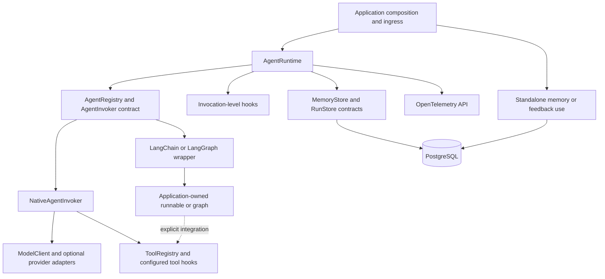

# Architecture

Reviewed against v0.4.2 source on 2026-10-28. This describes implemented behavior unless marked
**proposed**. [The plan](plan.md) owns future work; [ADRs](adr/README.md) explain decisions;
[runbooks](runbooks/README.md) explain operation. Release evidence is not production certification.
Development-source streaming changes added on 2026-10-29 are labeled below; they are not in the
immutable v0.4.2 release.

## Product boundary

Agent Runtime Kit is an **importable execution and persistence library** for application-owned
agents. Its reusable unit is one bounded invocation with canonical input, durable outcome and
explicit lifecycle policy. It is not the agent's business logic, a replacement for LangGraph,
an autonomous-agent platform or a durable workflow engine.

The host selects models, prompts, tools, authorization, configuration and deployment. It can use
the native loop, wrap a framework, implement an invoker, or use memory independently. The wheel
contains `agent_runtime`, not examples or applications. HTTP and Docker demonstrate hosting;
neither is required to import the library. See [ADR 0012](adr/0012-library-first-evolution.md).

## Components and dependency direction

Arrows show use/ownership, not an assertion that every component imports its implementation.

| Boundary | Owns | Does not own |
| --- | --- | --- |
| Models, protocols, errors | Canonical contracts and error categories | Vendor objects or universal payload validation |
| `AgentRuntime` | Routing, history, claims, deadline, invocation hooks, finalization and replay | Prompts, graph execution or resource construction |
| Native invoker | Sequential bounded model/tool loop and invocation token totals | Durable history or automatic retries |
| Framework wrappers | Input/output and optional stream translation | Framework-internal policy or persistent checkpointers |
| Provider adapters | Supported text/function-call wire subset and safe provider failures | Complete vendor parity or account configuration |
| PostgreSQL stores | Transactions, ordering, leases/fencing, replay, memory and feedback | External-effect transactions or tenant authentication |
| Host / optional service | Configuration, ingress, authorization, pools, signals and teardown | A second writer for runtime-owned conversation history |

Core imports must remain usable without HTTP, database or framework extras. Pydantic,
`pydantic-settings` and OpenTelemetry API are current core dependencies; this is not a
zero-dependency library. Optional implementations use explicit modules/lazy imports. Business
logic must not flow from examples or applications into the package.

**Development source:** iterator closure and terminal validation now live in private `_streams.py`.
Runtime no longer imports this utility from a framework-named module. No public API or additional
queue is introduced. The dated review retains the original v0.4.2 layering finding.

## Execution paths and policy coverage

All registered invokers enter the same durable runtime envelope. The native path calls the kit's
model client and tool registry. Framework wrappers call their supplied `ainvoke()` or opt-in
`astream()`; the kit does not take over graph internals.

| Policy / contract | Actual scope in v0.4.2 |
| --- | --- |
| `before_model` / `after_model` | Once around the complete invoker, despite the historical names; not each native model round |
| `before_tool` / `after_tool` | Only a configured `ToolRegistry` receiving a runtime context |
| Tool schema / timeout / iteration limit | Registry / native-loop policy, not automatically applied to framework-native tools |
| Runtime deadline and persistence | Invokers called through `AgentRuntime`, not direct component calls |
| Descriptor capabilities | Discovery metadata, not permissions or automatic feature negotiation |

The host deliberately shares hook/telemetry configuration where required. Supplying runtime hooks
does not configure tool registries automatically. Custom extensions are trusted code, not a sandbox.

Input hooks see loaded history plus the new request. Output hooks run before durable completion,
but stream deltas and tool-result events may already have been delivered when they block. Hosts
requiring pre-disclosure moderation must explicitly buffer/filter output; an output guardrail
is not a streaming confidentiality gate.

## One invocation and its durable outcome

1. Resolve the agent and hash semantic request fields, excluding generated request/message IDs.
2. For an existing agent-scoped idempotency key, verify namespace and request equivalence. Replay
   success; report an active conflict or unavailable failed/blocked outcome otherwise.
3. Create or verify the thread and claim its active run slot in a short transaction.
4. Transition to running, then load history. Only the owner executes hooks and agent work.
5. Apply output hooks, find the final assistant message and build the canonical response.
6. `RunStore.complete()` atomically commits the new request/output message batch and succeeded
   run/replay response. Only then can the runtime emit public `completed`.

The success path is `accepted -> running -> succeeded`; conditional failure/blocked cleanup
can settle either active state. Failed cleanup may leave active state until later lease recovery.
For ordinary completion errors, readable committed success wins during reconciliation. Cancellation
still propagates even if the transaction committed; an equivalent request can replay that success.

Keys are unique within `(agent_id, idempotency_key)`, not agent version, namespace, user or thread.
Successful replay returns the original response IDs, agent version and usage, without executing
models/tools again. Failed keys never implicitly restart execution.

## Persistence and concurrency invariants

PostgreSQL is the only shipped persistence backend. Memory is independently importable; runtime
memory and runs must share one persistence domain, normally one host-owned engine. Runtime
conversation history has one writer: no second framework memory/checkpointer or standalone append
to a live runtime thread.

- A database constraint permits one accepted/running owner per thread across agents. Live overlap
  is a conflict, not an internal work queue.
- Transactions are short; none spans a model/tool call. Mutations lock **thread, then run**.
- Owner tokens and database-clock leases fence mutations. Completion rechecks ownership after
  message flush; stale owners cannot overwrite a successor's durable result.
- Runtime leases cover invocation budget, cleanup budget and five seconds of grace. There is no
  heartbeat, indefinite renewal or library-owned recovery worker.
- Equivalent retry, new claim, explicit recovery or host maintenance can fail expired owners.
  Expiry alone does not change a row. Recovery terminates abandoned work; it never resumes it.
- Atomicity covers this invocation's new conversation batch and run/replay record only. Standalone
  memory writes, feedback, external tools and framework side effects are separate actions.

**Fencing is not exactly-once tool execution.** A cancellation-resistant tool may finish an
external action after its lease expires. Fencing prevents stale database finalization, not that
external effect. Hosts must reconcile effects and use domain-specific idempotency before starting
new work. There is no tool journal, outbox, compensation or resumable execution contract.

Namespaces filter access but are not authentication, tenant isolation or database RLS. Owner tokens
are concurrency capabilities, not authorization credentials. See [ADR 0009](adr/0009-fenced-thread-ownership.md).

## Streaming and canonical data

Provider model events become invoker events, then public runtime events. Runtime streaming uses
a 64-item queue for backpressure. Text/tool-result events are provisional. Replay returns the
stored outcome, not a saved token event log; SSE is not a resumable event service.

Framework wrappers default to terminal fallback and support explicit incremental streaming.
Built-in providers validate their supported protocols. **Development source** uses one private
validator for framework streams, custom model streams consumed by the native loop, and custom
invoker streams consumed by runtime. It withholds completion until normal source exhaustion,
rejects missing/duplicate completions and later events, and closes the source on failure,
cancellation or abandonment. Sources must terminate after completion; the invocation deadline
still applies while waiting for EOF. Direct calls to arbitrary custom implementations bypass these
kit boundaries. Published v0.4.2 lacks the generic model/invoker enforcement; remaining extension
result-consistency work is in [the plan](plan.md).

Canonical content is text, tool calls and tool results, not a universal multimodal/reasoning/artifact
format. `StrictModel` rejects extra fields; it is not globally strict or immutable. Text, content
part counts and metadata have limits, but custom tool arguments/results contain `Any` without a
universal JSON/byte bound. HTTP body and provider decoder limits are not whole-invocation bounds.

`ModelResult` duplicates tool calls in `message.content` and `tool_calls`; native execution uses
the latter. Built-in providers construct them together; custom results lack a consistency check.
One unambiguous ordered set of calls is the intended invariant; centralized enforcement is
**proposed**, not an existing guarantee.

Native usage sums every model call; any unknown call makes the invocation total unknown. Framework
conversion retains the last newly generated AI message that supplies usage unless an explicit
output envelope overrides it. Runtime stores the invoker's value unchanged. These are not uniformly
comparable billing totals; never add loaded historical usage again.

## Lifetime, limits and failure surfaces

One cooperative invocation budget includes lookup, claim, history, hooks, execution, partial-event
backpressure and finalization. Cleanup has a separate budget. Python cancellation cannot hard-kill
blocking code, synchronous tools running in threads or cancellation-suppressing extensions.
Downstream timeouts, admission control and process supervision remain host responsibilities.

`lifespan()` optionally checks shutdown and rejects overlapping/reopened lifetimes. It neither
creates nor closes injected engines, models or exporters. The host drains ingress, shuts down
runtime work, then closes dependencies. Provider-created clients close through their provider;
injected clients remain caller-owned. `PostgresMemoryStore.close()` disposes even an injected
engine, so it is not an isolated per-store close. See the [ownership guide](library-integration.md)
and [ADR 0011](adr/0011-managed-runtime-lifetime.md).

History loading reads the full conversation. Queue item count does not cap total history, tool
payloads, framework buffers or process memory. Pools and global concurrency are host-configured.
A context/history policy needs workload evidence before API design; there is no implicit truncation
or summarization.

Built-in translated failures use stable error categories, including safe provider failures.
Unexpected Python/store/hook errors can still propagate to direct callers: do not serialize their
tracebacks. The HTTP service supplies a sanitized public envelope. A retryable hint is not
permission to repeat unknown external effects.

## Security, observability and feedback

Kit telemetry defaults to identifiers, counts and categorical outcomes, with content capture off.
Hosts own third-party instrumentation and free-form logging. Explicitly constructing
`RuntimeSettings` reads environment and optional `.env`; runtime construction does not configure
the application.

Authorization, tenant boundaries, rate limits, TLS, secrets, backups, retention and network policy
belong to the host. Sample guardrails are composition examples, not a production safety system.
Liveness and readiness differ: readiness also checks database access and schema. Migrations run
explicitly outside application startup.

Feedback is immutable evidence linked to a successful artifact, with correction chains and
paginated reads. It never updates prompts, tools, memory, routing or models. Evaluation remains a
separate system using an explicit privacy-reviewed read/export boundary, not an implicit event bus.

## Evolution and evidence

Strengthen extension contracts and host adoption before adding an orchestrator, database, scheduler
or provider abstraction. Keep protocols at demonstrated replacement boundaries, prefer explicit
composition, and extract private helpers only for concrete invariants. No microservice split or
global dependency container is needed.

Python API, canonical contract version and database schema are separate compatibility axes.
Selected signature/OpenAPI snapshots and installed-wheel tests exist; they do not cover every
symbol or dependency permutation. Proposed fitness checks and rollout gates are in [the plan](plan.md).
The [dated review](validation/architecture-review-2026-10-28.md) records the evidence for these priorities.
